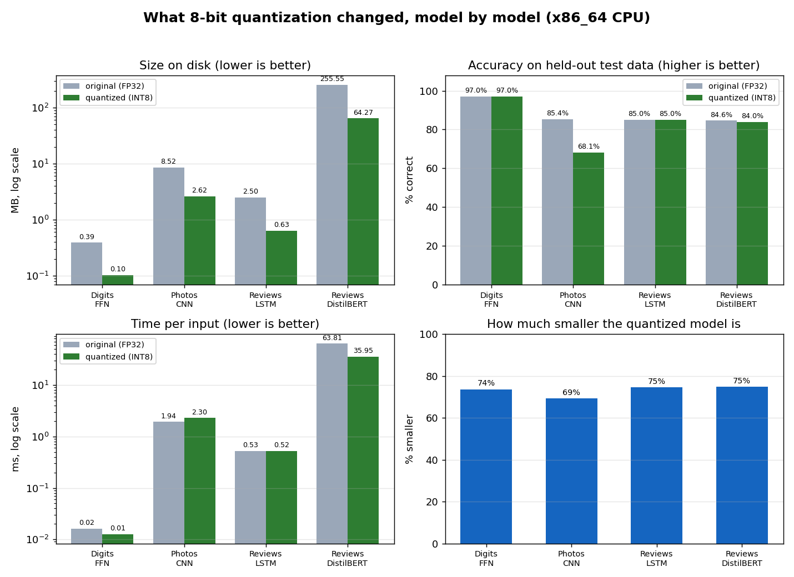
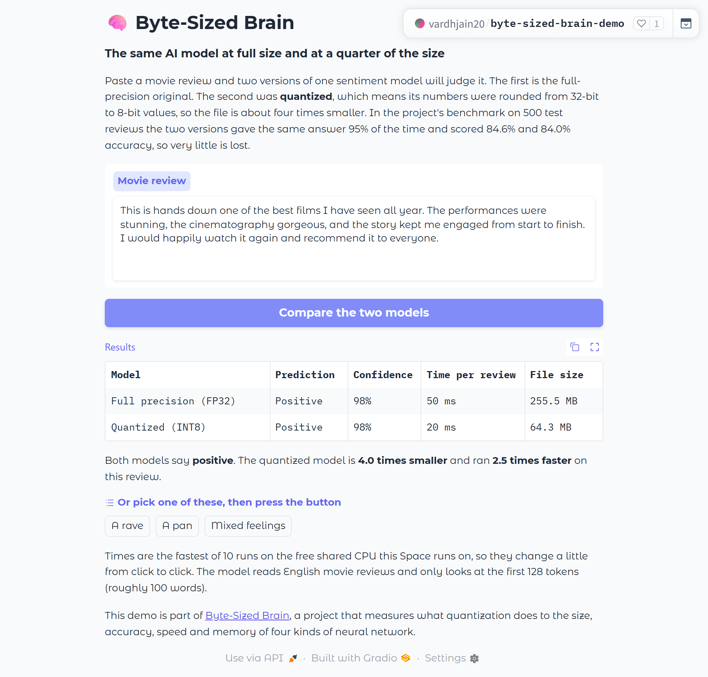
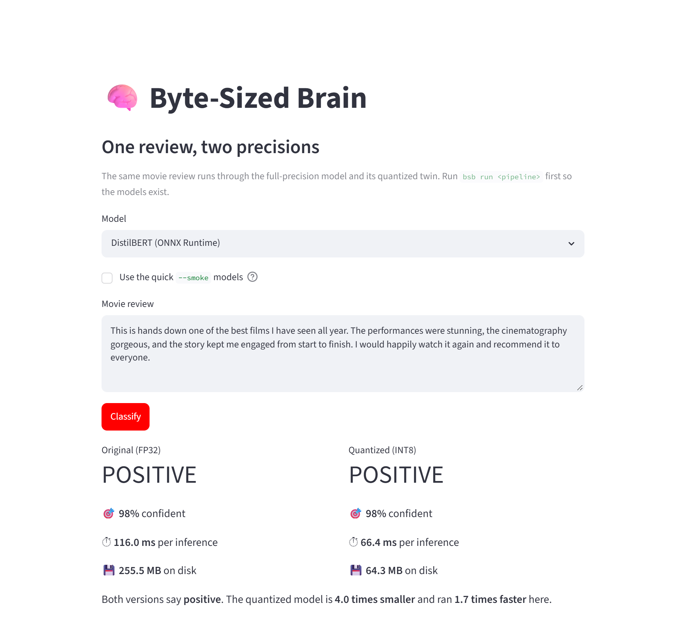
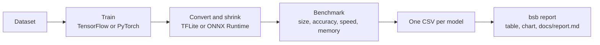

<div align="center">

# Byte-Sized Brain

### Quantization trade-offs across four ML models, with reproducible evidence

**[Live demo](https://huggingface.co/spaces/vardhjain20/byte-sized-brain-demo)** &nbsp;·&nbsp; **[Full results](docs/report.md)** &nbsp;·&nbsp; **[How it is measured](docs/methodology.md)** &nbsp;·&nbsp; **[Docs site](https://vardhjain.github.io/Byte-Sized-Brain/)**

[](https://github.com/vardhjain/Byte-Sized-Brain/actions/workflows/ci.yml)
[](https://codecov.io/gh/vardhjain/Byte-Sized-Brain)
[](pyproject.toml)
[](LICENSE)

</div>

## What this is

AI models are often too big and too slow for phones, cameras and other small devices.
A common fix is **quantization**, which represents model weights, and sometimes
the values passed between layers, with fewer bits. Like saving a smaller image
file, this can reduce storage and runtime memory use—but compression may change
what the model predicts.

"Most of the time" is not a measurement, though. Byte-Sized Brain trains or
fine-tunes four model families, converts each to a smaller inference format, and
evaluates each FP32/quantized pair through the same benchmark harness. How big is it? How often is it right? How fast does it answer? How much
memory does it need? The result is a straight answer to a practical question. When does
shrinking a model come for free, and when does it quietly break something?

## The engineering work

This is an inference-systems and ML-evaluation project—not just four trained
models. It combines TensorFlow/Keras, PyTorch, TFLite, ONNX Runtime and
native x86/ARM64 testing, with reproducible experiments and a browser demo.

| What I implemented | Where to verify it |
| --- | --- |
| Shared, batch-1 benchmark harness measuring accuracy, size, memory, model-only and input-preparation-inclusive latency | [Harness](src/byte_sized_brain/benchmark/harness.py) · [runners](src/byte_sized_brain/benchmark/runtimes.py) · [memory probe](src/byte_sized_brain/benchmark/memory.py) |
| Quantization experiments, including a depthwise-convolution ablation that explains the CNN accuracy drop | [Ablation script](scripts/cnn_int8_ablation.py) · [recorded ablation results](benchmarks/results/ablations/cnn_int8_ablation.csv) |
| Paired accuracy statistics and optional repeated-pass latency intervals | [Statistical implementation](src/byte_sized_brain/benchmark/statistics.py) · [tests](tests/test_statistics.py) |
| Architecture-to-architecture model provenance: SHA-256 verified TFLite/ONNX files reused across x86 and ARM64 | [Manual benchmark workflow](.github/workflows/arm-benchmark.yml) · [bundle verification](src/byte_sized_brain/benchmark/bundle.py) |
| Automated quality gates, native ARM64 tests, container smoke checks, and an interactive sentiment demo | [CI](.github/workflows/ci.yml) · [Docker CI](.github/workflows/docker.yml) · [demo](demo/hf_space/) |

**Evidence boundary:** The headline numbers below are **historical, single-session
model-only** benchmarks; x86 and ARM64 originally trained their models separately.
The newer paired uncertainty, prepared-input timing and identical-artifact
cross-hardware workflow are implemented and tested, but were **not** used to
produce those historical numbers. See [Reproduce and verify](docs/reproducibility.md)
for quick, low-cost checks and the steps required to produce new measurements.

## What it found

**Every model got much smaller.** Each shrunken model is 69 to 75 percent smaller than
the original. The largest one, a DistilBERT language model, went from 255.5 MB to
64.3 MB, and the memory it needs to run fell from about 275 MB to 88 MB.

**Three of the four kept their accuracy.** The handwriting reader scored 97.0 percent
before and after, and the LSTM review classifier scored 85.0 percent before and after.
The DistilBERT review classifier went from 84.6 to 84.0 percent—three more
errors in 500 test reviews. That small difference is not evidence of equivalence;
the historical result files lack paired confidence intervals.

**One model paid a real price.** The photo classifier fell from 85.4 to 68.1 percent,
getting 173 more of 1,000 test photos wrong. The [investigation below](#why-the-photo-classifier-lost-accuracy)
shows where that loss comes from and how to avoid nearly all of it.

**Speed depended on the model and on the processor.** On an x86 laptop, DistilBERT
and the tiny handwriting reader both answered about 1.8 times faster, while the LSTM
and the photo classifier took about the same time as before. On an ARM server
processor every shrunken model was faster, from 1.3 times for the LSTM to 3.6 times
for DistilBERT. Smaller does not automatically mean faster. Those ARM results came
from **separately trained model artifacts**, however, and should not be treated
as a controlled same-weights comparison across processors.

Each row below compares the original model with its shrunken version.

<!-- RESULTS_TABLE -->

| Model (dataset) | Method | Size on disk | Accuracy | Time per input | Memory |
| --- | --- | --- | --- | --- | --- |
| Digit reader (MNIST) | Static INT8 | 0.39 → 0.10 MB (74% smaller) | 97.0% → 97.0% (no change) | 0.022 → 0.012 ms (1.8× faster) | 1.97 → 1.39 MB |
| Photo classifier (CIFAR-10) | Static INT8 | 8.52 → 2.62 MB (69% smaller) | 85.4% → 68.1% (-17.3 pts) | 1.99 → 2.14 ms (about the same) | 20.1 → 7.53 MB |
| Review sentiment, LSTM (IMDB) | Dynamic INT8 | 2.50 → 0.63 MB (75% smaller) | 85.0% → 85.0% (no change) | 0.54 → 0.61 ms (about the same) | 4.01 → 2.19 MB |
| Review sentiment, DistilBERT (IMDB) | Dynamic INT8 | 255.5 → 64.3 MB (75% smaller) | 84.6% → 84.0% (-0.6 pts) | 99.1 → 54.5 ms (1.8× faster) | 275.4 → 88.0 MB |

_Each cell reads original (FP32) → quantized (INT8). Time is the average for one input on a native x86_64 CPU, and memory is what the process gains by loading and running the model, so lower is better for both. Generated by `bsb report` from `benchmarks/results/*.csv`, which also record p50 and p95 latency. The per-variant table is in [docs/report.md](docs/report.md)._



<!-- /RESULTS_TABLE -->

<details>
<summary><b>New to these terms? A one-minute glossary</b></summary>

| Term | In plain words |
| --- | --- |
| Model | A program that learned a task from examples instead of being written rule by rule. |
| Quantization | Storing a model's numbers with fewer bits so it takes less space and memory. |
| Post-training quantization | Quantizing a model after it has been trained, without training it again. |
| FP32 | 32-bit floating-point numbers, the usual precision a model is trained in. |
| INT8 | 8-bit integers, which can hold 256 different values. |
| Weights and activations | Weights are the numbers a model learned and stores. Activations are the in-between numbers it computes for each input. |
| Calibration | Running a few hundred real examples through the model to measure the typical range of its activations. |
| Static INT8 | Weights and activations are both 8-bit, with activation ranges fixed ahead of time by calibration. |
| Dynamic INT8 | Weights are stored as 8-bit and activation ranges are worked out on the fly for each input. TensorFlow Lite calls this "dynamic-range" quantization. |
| Accuracy | The share of held-out test examples (ones the model never saw in training) that it gets right. |
| Latency | How long the model takes to answer one input, in milliseconds (ms). |
| p50 and p95 | The median time, and the time that 95 percent of inputs finish within. |
| TensorFlow Lite (TFLite) | Google's engine for running models on phones and small devices. |
| ONNX Runtime | Microsoft's engine for running models saved in the open ONNX format. |
| x86 and ARM | The two main processor families. x86 is in most laptops and desktops. ARM is in phones, Raspberry Pis and many cloud servers. |

</details>

## Try it in your browser

The [live demo](https://huggingface.co/spaces/vardhjain20/byte-sized-brain-demo) runs a
movie review through the original and the shrunken DistilBERT model side by side, and
shows each one's verdict, confidence, speed and size. It is hosted on a free Hugging
Face server that sleeps when nobody is using it, so the first visit can take a minute
to wake up.



## The four models

| What it does | Learned from | Model | Built with → run with | Shrunk with |
| --- | --- | --- | --- | --- |
| Reads handwritten digits (`ffn_mnist`) | MNIST, 70,000 small images of handwritten digits | A feed-forward network, the simplest kind of neural network | TensorFlow → TFLite | Static INT8 |
| Sorts small photos into 10 categories such as cat, ship and truck (`cnn_cifar10`) | CIFAR-10, 60,000 tiny color photos | MobileNetV2, a compact image network designed for phones, with a small classifier on top | TensorFlow → TFLite | Static INT8 |
| Tells whether a movie review is positive or negative (`rnn_imdb`) | IMDB, 50,000 movie reviews | An LSTM, a network that reads text one word at a time | TensorFlow → TFLite | Dynamic INT8 |
| The same review task (`distilbert_imdb`) | IMDB | DistilBERT, a smaller and faster version of the BERT language model | PyTorch → ONNX Runtime | Dynamic INT8 |

The names in backticks are what you pass to the `bsb` command. The LSTM uses dynamic
INT8 because TensorFlow Lite's fully 8-bit mode does not support LSTM layers well.

## Why the photo classifier lost accuracy

The photo classifier is the one model that paid for its smaller size, so it got a closer
look. The same trained model was converted nine different ways and each version was
scored on the same 1,000 test photos.

| Version | Accuracy | Size |
| --- | --- | --- |
| Original (FP32) | 85.4% | 8.52 MB |
| Fully 8-bit (the benchmarked version) | 68.1% | 2.62 MB |
| Fully 8-bit, calibrated on 4 times more photos | 68.6% | 2.62 MB |
| 8-bit weights only, activations left in 32-bit | 86.0% | 2.42 MB |
| Fully 8-bit except the depthwise layers | 81.2% | 2.64 MB |

More calibration data did not help. Shrinking only the stored weights cost nothing, and
that version is even smaller than the fully 8-bit one. So the loss does not come from
the weights. It comes from rounding the activations to 8 bits, mostly inside
MobileNetV2's depthwise layers (layers that filter each feature channel separately).
Keeping just those layers in 32-bit recovers most of the gap for almost no extra size.

The practical lesson is that the "8-bit weights only" version is the better choice for
this model on a CPU. The full experiment is one script,
[`scripts/cnn_int8_ablation.py`](scripts/cnn_int8_ablation.py), its results are in
[`benchmarks/results/ablations/`](benchmarks/results/ablations/cnn_int8_ablation.csv),
and the [methodology](docs/methodology.md#5-limitations) discusses it further.

### Benchmark the alternatives with the shared harness

The two most promising strategies are now opt-in variants of the normal CNN pipeline:

```bash
bsb train cnn_cifar10                     # once, or use an existing trained model
bsb convert cnn_cifar10 --cnn-alternatives
bsb benchmark cnn_cifar10 --cnn-alternatives
bsb report                                # compare all variants in docs/report.md
```

This benchmarks four versions of **the same trained model and test images**:
`fp32`, `int8`, `dynamic_range` (INT8 weights, float activations), and
`int8_except_depthwise` (selective INT8 with depthwise layers in float).
The full-size, accuracy, mean/p50/p95 latency, and RSS measurements go into the
same run ID, so the detailed report can compare them without mixing devices.
The headline table deliberately keeps the original FP32 vs. static INT8 comparison.

These variants are optional, so `bsb run all` and CI behave as before.
Selective depthwise quantization uses an **experimental TensorFlow API** and may
not be available in every version; dynamic-range is the stable fallback. The
accuracy/size figures above are from the original ablation, **not** from a
new end-to-end benchmark of these additional variants.

## Choose the smallest or fastest acceptable model

Benchmarks are more useful when they help answer a deployment decision.
The **constraint-based recommender** filters *real, native benchmark rows*
by accuracy loss, latency, disk size and RSS memory, then shows which
measured variants satisfy the limits and which were rejected.

```bash
# No ML framework, model download or retraining is needed:
bsb recommend ffn_mnist --max-size-mb 0.2 --max-accuracy-drop-pts 1
bsb recommend cnn_cifar10 --max-size-mb 3 --max-accuracy-drop-pts 1
```

The historical MNIST results have a feasible INT8 model; the historical CNN
FP32 model exceeds 3 MiB and the static INT8 variant loses too much
accuracy, so the second command reports **no feasible model**. It never
substitutes an unmeasured dynamic-range ablation result.

Use `--objective size` or `--objective latency` to set the goal,
`--arch aarch64` to choose a native ARM experiment, and `--json`
for machine-readable output. For conservative paired-accuracy confidence
bounds, use `--require-paired-ci` **after collecting a modern paired
benchmark**; the historical CSVs lack those intervals.

[Full options, selection algorithm and limitations](docs/recommender.md).

## Run it yourself

**Fast verification, without downloading models or training anything:**

```bash
python -m pip install -c requirements.txt -e ".[dev]"
bsb list
pytest -m "not smoke" tests
```

These checks exercise the framework-independent implementation; tests requiring
uninstalled ML frameworks may skip. CI separately installs TensorFlow and other
required runtimes. Full instructions and a verification checklist are in
[Reproduce and verify](docs/reproducibility.md).

**Reproduce training and conversion** (heavier; downloads ML frameworks and datasets):

You need Python 3.11 or 3.12. The pinned install includes both TensorFlow and PyTorch,
which is several gigabytes. Datasets and pretrained weights download on first use, about
half a gigabyte more for all four models (the digit reader alone needs about 11 MB).

```bash
git clone https://github.com/vardhjain/Byte-Sized-Brain
cd Byte-Sized-Brain
pip install -r requirements.txt   # the exact versions behind the committed results
pip install -e .                  # installs the `bsb` command

bsb list                          # the four models and how each one is shrunk
bsb run ffn_mnist                 # train, shrink and measure the digit reader (about a minute)
```

`bsb run` adds a new run (with its own ID) to that model's CSV in
`benchmarks/results/`, preserving previous runs, even from the same CPU architecture.
`bsb report` uses the newest complete native FP32/INT8 pair per pipeline to
rebuild the table above, the chart and `docs/report.md`.

To check that everything works without waiting for full training, add `--smoke`. It
trains each model briefly on a small slice of data (roughly 10 to 20 minutes for all four on a
laptop), keeps its files in separate `smoke/` folders, and never touches the committed
results. Smoke models are barely trained, so their accuracy numbers mean nothing.

```bash
bsb run all --smoke
```

### Compare x86 and ARM using exactly the same model files

For an apples-to-apples hardware experiment, start the manual
[Cross-hardware benchmark workflow](.github/workflows/arm-benchmark.yml)
from the GitHub **Actions** tab. It trains/converts a model **once** on x86,
uploads the inference artifacts with SHA-256 checksums, then benchmarks the
identical files on native x86 and ARM64 GitHub-hosted runners. A final gate
checks that model hashes and test sample counts match; each CSV row also
records its `model_sha256`.

The default `ffn_mnist` selection is relatively inexpensive; other models,
especially full `distilbert_imdb` training, take substantially longer.
The workflow is **manual only**, and uses account GitHub Actions/storage
allowances (not a paid GPU service). Download the separately labeled
`results-x86_64` and `results-aarch64` artifacts after a successful run.
These are not automatically mixed into the historical results: the earlier
ARM64 measurements used separately trained models. See the
[methodology](docs/methodology.md#3-running-on-arm64) for limitations.

### Controlled MNIST results: input preparation changes the answer

A new native x86/ARM64 MNIST comparison uses **the exact same FP32 and INT8
model bytes on both CPUs**, verified by SHA-256. INT8 made the model call
**2.07× faster on x86** and **2.53× faster on ARM64**, but float-to-INT8 input
preparation made the total `prepare() + invoke()` path **55% slower** on x86
and **24% slower** on ARM64. Both variants retained about 97% accuracy on
1,000 held-out digits.

[Read the controlled hardware case study](docs/mnist-cross-hardware.md) or
[inspect the archived CSVs and manifests](benchmarks/results/cross_hardware/2026-10-27-ffn-mnist/).
The first Actions run's final comparison **job** failed because its
no-dependency Python environment could not import NumPy; both benchmark
jobs succeeded and the archive was independently checksum-verified. A
standard-library-only verification fix and regression test are included
with this snapshot. These *new* MNIST measurements are kept separate
from the original, independently trained four-model headline results.

### Model-only latency versus input preparation

Every new benchmark now records **both** the existing model-only inference
latency and a prepared-input inclusive latency: `runner.prepare() + runner.invoke()`.
The extra measurement captures work such as float-to-INT8 tensor conversion that
the model-only timer intentionally excludes. The report shows preparation cost,
inclusive mean/p50/p95, and the paired FP32-versus-quantized inclusive speedup.

The inclusive measurement starts from a **ready evaluation example**, not a raw
photo or review. Loading images, resizing, normalizing, text tokenization,
model startup, network transfer, and decoding output labels are outside its
scope. Published October 2026 headline timings remain **model-only**, and older
CSV rows have no inclusive measurements until the benchmarks are rerun.
See [the measurement methodology](docs/methodology.md#1-what-is-measured).

### Measure variability, not just one timing run

You can opt into repeated passes for a more defensible latency comparison:

```bash
bsb benchmark ffn_mnist --repeats 5
bsb benchmark cnn_cifar10 --cnn-alternatives --repeats 5
bsb report
```

All passes use the same held-out examples; the detailed report adds mean-latency
pass-to-pass variation and a 95% bootstrap interval. It also reports a paired
accuracy-difference interval and exact McNemar test from the same examples
used by FP32 and quantized variants. Those statistics are **not** available
for older CSVs, and a single timing pass does not imply a latency uncertainty
interval. See [methodology](docs/methodology.md#sample-sizes-and-noise).

To compare the two versions of a model on a movie review, build it and run the demo.

```bash
bsb run distilbert_imdb           # full training, the slowest of the four on a CPU
bsb demo distilbert_imdb          # built-in example reviews, or pass your own in quotes
```

```
"This is hands down one of the best films I have seen all year. The per..."
  variant       prediction    conf    latency      size
  ----------------------------------------------------
  fp32          POSITIVE    97.8%    29.89ms  255.55MB
  int8          POSITIVE    97.5%    19.78ms   64.27MB
```

These timings are much lower than the table above (about 30 ms against 99 ms for the
original model) because the two are measured differently. The demo reports the single
fastest of 15 runs on one review, while the benchmark reports the average over 500
different reviews, slow runs included, on a machine that was busier at the time. Do not treat that best-of-15 demo measurement as comparable to the
full benchmark mean, or expect its speed ratio to transfer between machines.

A local web version of the demo is `pip install -e ".[all,demo]"` followed by
`streamlit run demo/app.py`.



## How it works

Every model goes through the same three steps, and `bsb run` does all three.



```bash
bsb train     <model>   # train the original 32-bit model
bsb convert   <model>   # write the original and the 8-bit version
bsb benchmark <model>   # measure both and write benchmarks/results/<model>.csv
```

Prefer Make? `make help` lists every target, including `make check` (lint, type check
and tests) and `make smoke-all`.

## How the numbers are measured

| What | How |
| --- | --- |
| Hardware | Intel Core i7-10710U laptop processor (6 cores), Windows 11, CPU only |
| Inputs | One at a time (batch size 1), the way a device answers a single request |
| Test data | 1,000 held-out test images for the digit and photo models, 500 held-out test reviews for the two review models, identical for both versions of a model |
| Timing | Mean, p50 and p95 of the model call alone, after 5 warm-up runs |
| Memory | How much the process's memory grows when it loads and runs the model, measured in a fresh process for every version |
| Threads | TensorFlow Lite uses one thread and ONNX Runtime uses all cores, so compare each model only with its own original |
| Versions | TensorFlow 2.21.0, PyTorch 2.7.0, Transformers 4.57.6, ONNX Runtime 1.24.1 |

A few things are worth knowing when reading the numbers.

- With 500 test reviews, one review is 0.2 percentage points. The historical
  per-model Wilson intervals do **not** establish whether a small FP32/INT8
  accuracy difference is significant, because both variants see the same examples.
  New runs compute paired bootstrap intervals and exact McNemar tests. The photo
  classifier's 17.3-point drop is large in practical terms.
- The result files also record how often the two versions of a model give the same
  answer. DistilBERT's two versions agree on 477 of 500 reviews, and the photo
  classifier's on 699 of 1,000.
- Timings come from a single run on a laptop and move with whatever else the machine is
  doing. Differences of 10 to 20 percent between runs are normal.
- Calibration uses real training examples, never random noise, because noise teaches the
  converter the wrong ranges.
- Every result row records the processor, operating system, Python and library versions
  that produced it. New runs also share a `run_id` across their FP32 and INT8 rows,
  so the report never compares different experiment sessions.

The [methodology](docs/methodology.md) covers each choice in detail.

## Running on ARM processors

Phones, Raspberry Pis and many cloud servers use ARM processors, so the whole benchmark
was also run on one. The table above is from the x86 laptop. The table below is the
same code and configs on a GitHub-hosted ARM64 machine (Arm Neoverse-N2, 4 virtual
CPUs), where each model was trained, shrunk and measured from scratch.

| Model (dataset) | Accuracy | Time per input | Memory |
| --- | --- | --- | --- |
| Digit reader (MNIST) | 97.0% → 97.1% | 0.011 → 0.004 ms (2.5× faster) | 3.65 → 3.00 MB |
| Photo classifier (CIFAR-10) | 85.4% → 68.8% (-16.6 pts) | 2.97 → 1.19 ms (2.5× faster) | 21.6 → 9.00 MB |
| Review sentiment, LSTM (IMDB) | 85.0% → 85.0% | 0.51 → 0.41 ms (1.3× faster) | 5.13 → 3.45 MB |
| Review sentiment, DistilBERT (IMDB) | 84.8% → 83.4% (-1.4 pts) | 61.8 → 16.9 ms (3.6× faster) | 347.2 → 115.1 MB |

File sizes are the same as on x86. The accuracy story repeats, including the photo
classifier's drop, and the speed story changes. The fully 8-bit photo classifier, which
was no faster on the laptop, runs 2.5 times faster here, because ARM processors have
fast 8-bit arithmetic that this laptop's processor lacks. Two cautions apply. The ARM
models were trained separately, so their accuracies differ slightly from the x86 ones,
and a shared cloud machine is a noisier place to time things than a dedicated one.
These rows live in the same result files as the x86 rows, and
[docs/report.md](docs/report.md) lists both.

The **historical ARM64 run** trained a different model on that machine.
To produce a controlled comparison with identical model bytes, use the
[manual cross-hardware workflow](.github/workflows/arm-benchmark.yml). It
trains and converts once, verifies SHA-256 checksums and benchmarks both native
architectures. It has not yet produced a replacement published dataset.
CI also runs tests and TensorFlow Lite conversion on native ARM64 for every
change to `main` and every pull request; ARM emulation is used for functional checks.

```bash
make docker-build-arm   # build an ARM (aarch64) Docker image, emulated with QEMU
make benchmark-arm      # a tiny run of every model inside it, to prove they load and run
```

Emulation translates every ARM instruction in software, so its timings are not
meaningful and its results stay out of the report. To add timings from your own ARM
machine (a Raspberry Pi, AWS Graviton or Oracle Ampere), run
`BSB_DEVICE=raspberry-pi bsb benchmark ffn_mnist` there after transferring
the **same verified artifacts** and installing dependencies. Use
`bsb run all` only if you specifically intend to train different models on
that machine. Each result row is stamped with its
processor architecture, so new rows sit next to the existing ones without replacing
them.

## Project layout

```
configs/               one YAML file per model, plus a small "smoke" override block
src/byte_sized_brain/
  cli.py               the `bsb` command
  data/                MNIST, CIFAR-10 and IMDB loaders
  models/              the four model definitions
  convert/             TFLite and ONNX conversion and quantization
  benchmark/           the shared measurement loop, memory probe and runners
  pipelines/           train, convert and benchmark for each model
  report.py            builds the results table, chart and docs/report.md
benchmarks/results/    the committed result CSVs
demo/                  the Streamlit app and the hosted Gradio demo
docker/                x86 and ARM images
docs/                  methodology, generated report, charts and the docs site
scripts/               one-off experiments, such as the photo classifier investigation
tests/                 unit tests and end-to-end smoke tests
artifacts/             trained models (not committed, rebuilt on demand)
```

## Limitations

- The photo classifier reuses a pretrained MobileNetV2 without retraining its layers
  (a frozen backbone), trained on 12,000 photos to keep it feasible on a CPU. Its 85.4
  percent is a fair baseline for comparing the two versions, not a best-possible score.
- DistilBERT is also trained on a reduced budget (3,000 reviews, inputs cut to 128
  tokens), which is why it scores no better than the LSTM here. The comparison between
  its two versions does not depend on that.
- The committed numbers come from two machines, one x86 laptop and one shared ARM64
  cloud runner, each measured once **with separately trained models**. Neither
  hardware differences nor small accuracy differences have controlled estimates
  of cross-run variability. The checksum-verified cross-hardware workflow is
  available for future controlled experiments.

## Credits

| Resource | Source | License or terms |
| --- | --- | --- |
| MNIST | LeCun, Cortes and Burges | CC BY-SA 3.0 |
| CIFAR-10 | Krizhevsky, "Learning Multiple Layers of Features from Tiny Images", 2009 | Cite the report |
| IMDB reviews | Maas et al., "Learning Word Vectors for Sentiment Analysis", 2011 | Research use, cite the paper |
| MobileNetV2 ImageNet weights | Keras Applications | Apache 2.0 |
| DistilBERT (`distilbert-base-uncased`) | Hugging Face | Apache 2.0 |

## License and author

Built by [Vardh Jain](https://github.com/vardhjain). Released under the [MIT license](LICENSE).
